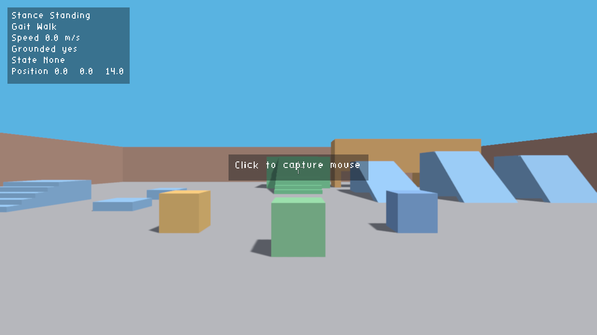
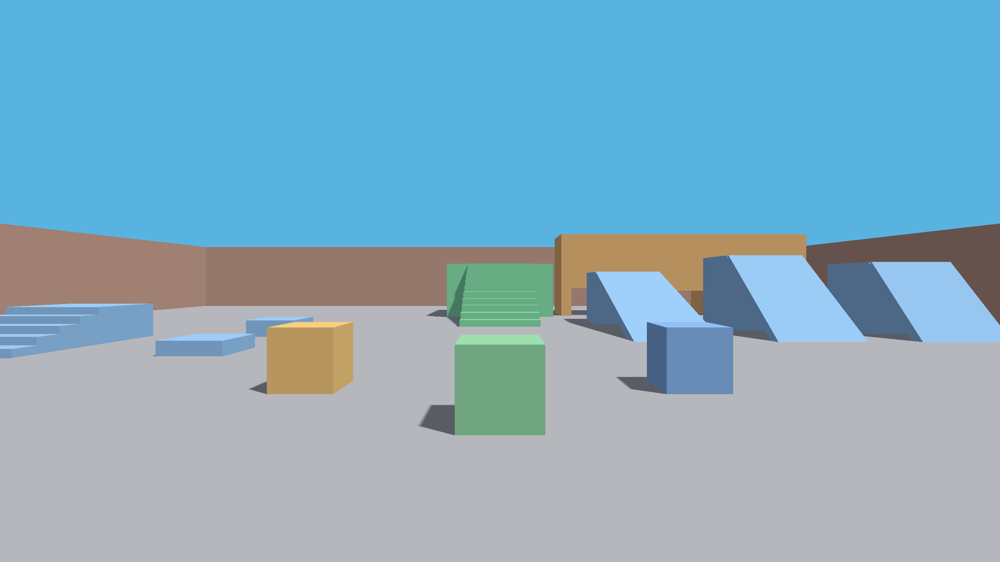
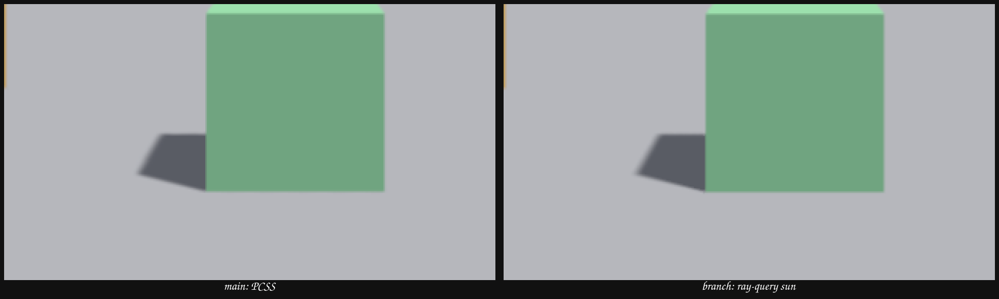

# Shadow evidence

Captured on 2026-10-24 at 2560x1440 from the offscreen harness, with no HUD.
GPU: AMD Radeon RX 9060 XT (RADV GFX1200).

- Before: `main` at `d265599`. Percentage-closer soft shadows over a 4096
  shadow map.
- After: `fix/ray-query-shadows`. Ray-query sun shadows with 16 sun samples.

The game window now opens fullscreen at the display's resolution. The offscreen
captures use the same renderer path at 2560x1440.





## Zoom

2x nearest-neighbor crop of the green crate and its shadow. The PCSS path
quantizes the shadow shape and the penumbra. The ray-query path has an exact
shape and a smooth penumbra. The remaining diagonal steps are screen pixels at
2560x1440, not shadow-map texels.



## Checks

- `make check` passes.
- `make test` passes: 1 physics, 108 simulation, 7 frame, 28 harness, and 4
  renderer tests.
- `make validate` ran both offscreen and present scenarios with
  `VK_LAYER_KHRONOS_validation`. No `VUID` or `[ERROR]` lines.
- The fullscreen app ran with validation. No `VUID` or `[ERROR]` lines.

## Sun angular diameter

The 3° sun disk that the ray-query path shipped with was too wide. The penumbra
widened quickly even close to the point of contact, so a wall shadow read as a
gradient instead of a shadow, most of all when the sun sat low. The penumbra is
linear in the disk diameter, so one art constant set the whole problem.

Measured on `scenarios/shadow-angle.json`, top-down over the wall shadow edge at
a 15° sun, 1280x720: the 10% to 90% transition is 72 px at 3° and 13 px at
0.53°, a ratio of 5.5. The shader is correct; the constant was not. The build
now ships the real 0.53° disk, and the harness `sun` command sets the diameter
so the comparison needs no rebuild.

```sh
./bin/harbagsa-agent run scenarios/shadow-angle.json --out runs/shadow/angle
```

The same run holds `wall-wide-sun.png` and `wall-real-sun.png` from the floor
view.
