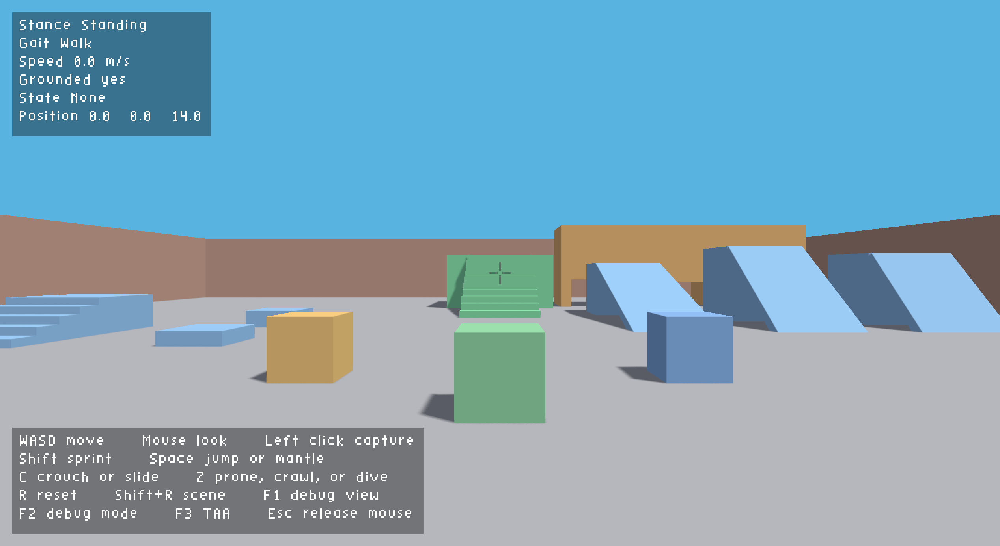
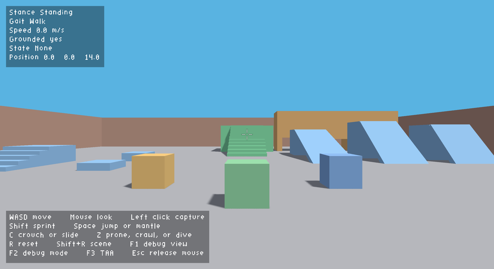
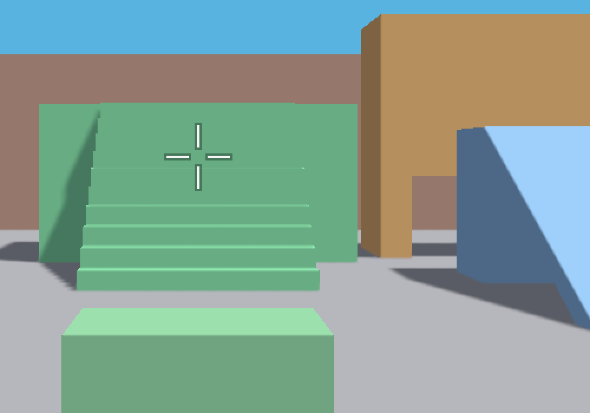
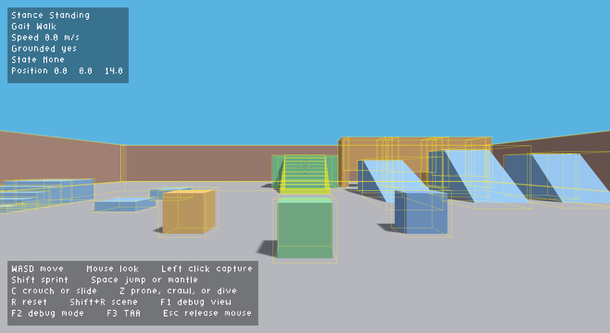
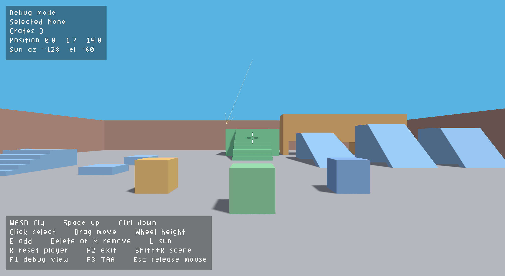
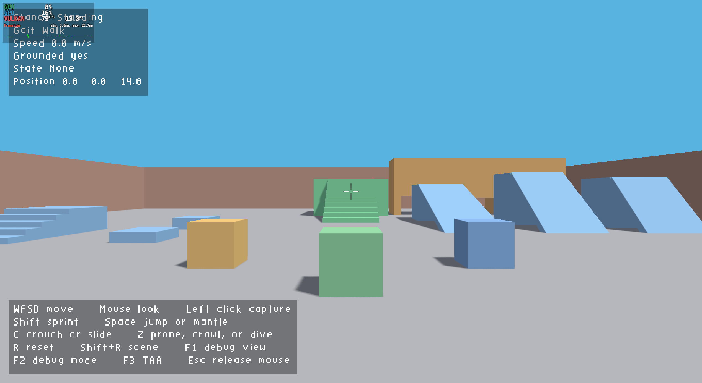

# TAA evidence

Captured on 2026-10-23 from `main` at `363041e` (merge of #62). GPU: AMD Radeon RX 9060 XT (RADV GFX1200). Window: 2536x1386. This is larger than the 1280x720 acceptance target.

## Still camera

The camera does not move between the two images. `F3` toggles TAA. The HUD and the crosshair are drawn after the resolve, so they stay crisp.

TAA on:

TAA off:

### Edge crop

2x nearest-neighbor crop of the green crate and the blue ramp. TAA smooths the diagonal edges. With TAA off, the edges show stair-steps.

| TAA on | TAA off |
| --- | --- |
|  |  |

## Walking, crate push, and reset

[Walking clip](taa/walking.mp4), 4 seconds at a 12 fps capture rate. The camera walks into the green crate and pushes it. `R` returns the player to spawn and clears the history. The crate leaves no trail, and the reset does not smear.

The clip capture runs at 12 fps. The demo runs at 60 fps.

## HUD and debug view

`F3` is in both control panels. `F1` draws exact outlines. `F2` enters debug mode and keeps `F3` active.

## Performance

MangoHud reports 60 fps and 16.7 ms at 2536x1386. The GPU load is 8%. The 1280x720 target is smaller.

## Validation

`make validate` ran with `VK_LAYER_KHRONOS_validation` for 15 seconds. The log had no `VUID` or `[ERROR]` lines. The target runs the demo until it closes, so the run was stopped after the checks.

The validation layer found a pre-existing swapchain semaphore reuse error. #24 fixes it with one render-finished semaphore per acquired image.
