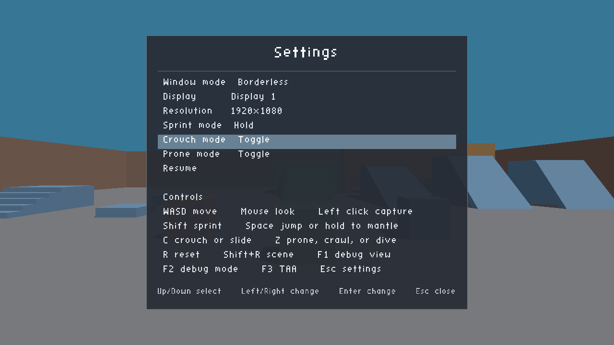
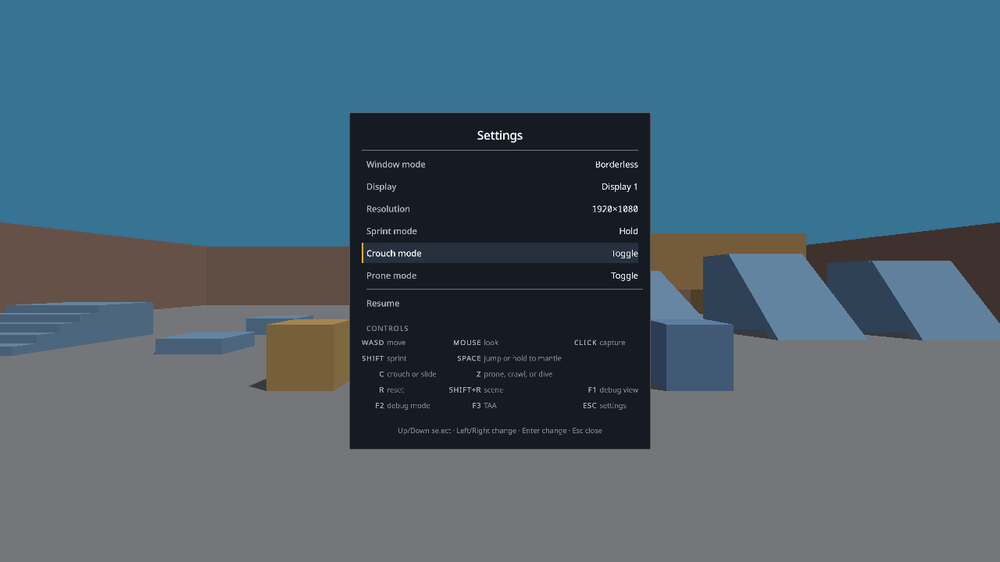
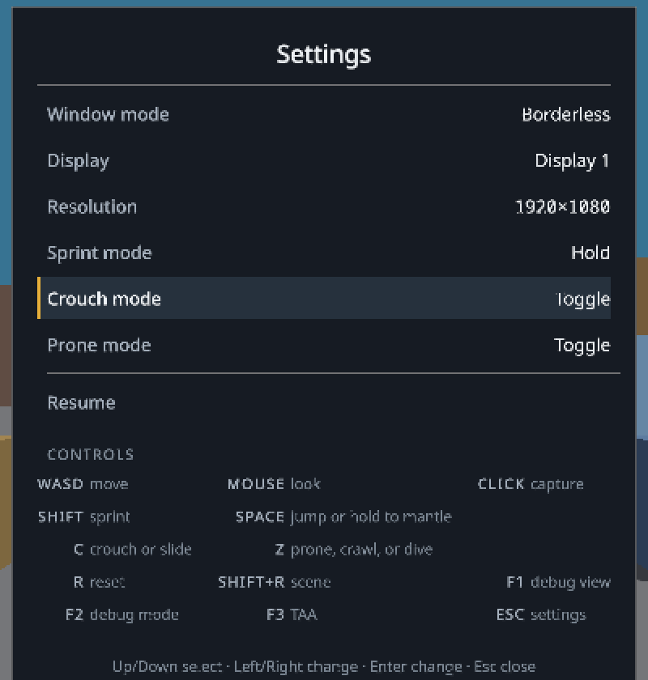
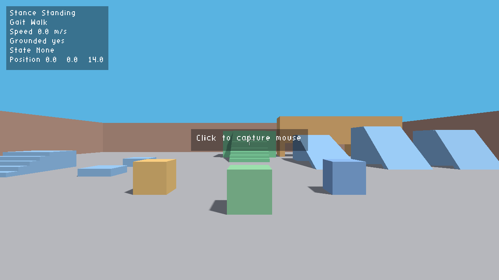
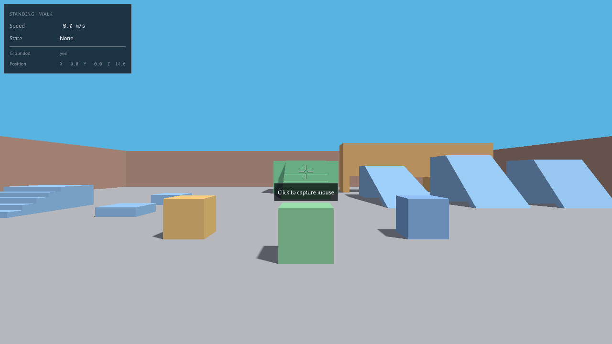
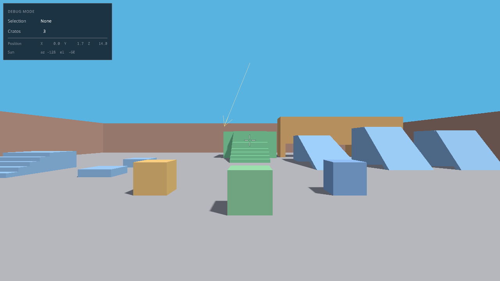

# UI evidence

The 2D layer is drawn by the overlay pass: a status panel, a capture hint, a
crosshair, and the settings panel. These captures come from
`bin/harbagsa-agent` at 1280x720. The recipe is in
`docs/agents/harness.md`.

## Settings panel

| Before | After |
| --- | --- |
|  |  |

What changed:

- Text is Noto Sans drawn from a signed distance field atlas, so it is
  antialiased at every window size instead of a 1 px bitmap scaled by a
  fraction.
- Values sit on one column at the panel's inner edge. The old layout padded with
  `%-12s`, which spread the value column over a 16 px range because the font is
  proportional.
- The selected row lifts to a lighter surface and carries a 2 px amber bar. The
  old selection filled the row with a blue that measured 4.2:1 against white
  text, under the 4.5:1 floor.
- `Controls` is a section header in tracked capitals, not a row that looks
  selectable.
- The control list is a key legend: keys are set against their action in three
  measured columns instead of runs of four spaces.
- `1920×1080` uses the multiplication sign.

The same panel at 2x, for reading the type:

## Status panel

| Before | After |
| --- | --- |
|  |  |

What changed:

- One heading carries the stance and the gait. Speed and movement state are
  body rows. Grounded and position are caption rows. The old panel drew six
  lines at one size and one colour.
- Every number that changes during play is formatted into a fixed field and drawn
  in Noto Sans Mono, so the row width never changes and the panel never resizes
  as the player walks. A test holds this.
- The position names its axes.
- The capture hint sits below the crosshair. The old hint was centre-anchored
  and the crosshair drew straight through the text.

## Debug readout

The debug mode readout uses the same row renderer: a heading, two metrics, a
divider, and two caption rows. `scenarios/hud-debug.json` produces it.
